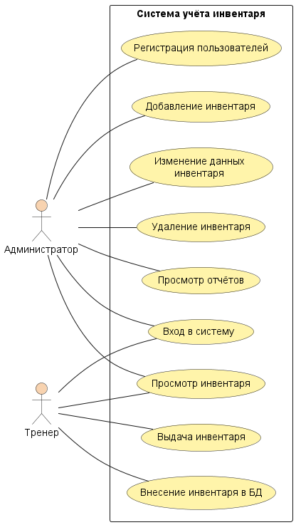
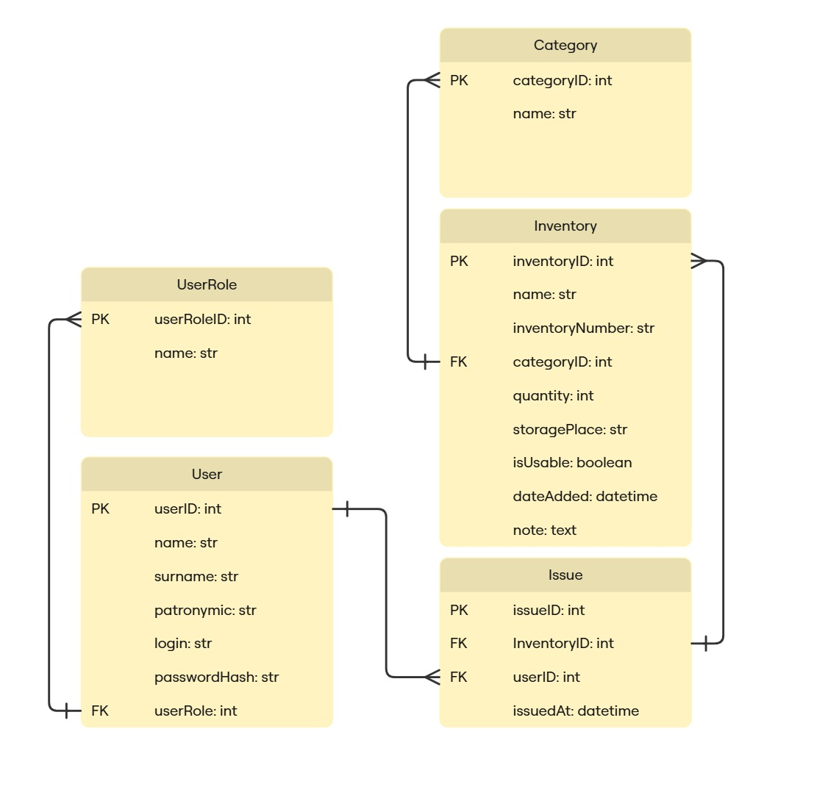

# Учёт спортивного инвентаря в зале

Учебный проект по дисциплине «Информационные системы». Лабораторные работы №1, №2 и №3.

**Автор:** Смирнов Степан, группа 26ИВТ-2-1

## Описание проекта

Система предназначена для хранения информации о спортивном оборудовании и контроля его **наличия** и **состояния**. Она заменяет учёт в разных журналах и документах единой базой данных.

Для каждого вида инвентаря хранятся:

- название и категория;
- *количество* (в зале может быть несколько одинаковых предметов);
- место хранения;
- состояние и дата поступления;
- инвентарный номер и примечание.

## Архитектура и стек технологий

- **Язык программирования:** Python
- **База данных:** SQLite

## Пользователи системы

| № | Пользователь | Роль в системе |
|---|---------------|-----------------------------------------------------------------------------------------------------------------------------|
| 1 | Администратор | Входит в систему, регистрирует пользователей, добавляет, просматривает, изменяет и удаляет инвентарь, просматривает отчёты |
| 2 | Тренер | Входит в систему, просматривает инвентарь, вносит инвентарь в базу данных и оформляет выдачу |

## Основные функции

1. Вход в систему (авторизация пользователей).
2. Регистрация пользователей системы.
3. Добавление нового инвентаря с указанием количества.
4. Просмотр инвентаря, его количества и состояния.
5. Изменение данных об инвентаре.
6. Удаление инвентаря.
7. Внесение инвентаря в базу данных.
8. Выдача инвентаря с проверкой количества и состояния.
9. Просмотр отчётов.

## База данных и архитектура (ЛР №3)

Проект использует реляционную базу данных **SQLite**. Структура спроектирована на основе ER-диаграммы и включает 5 основных таблиц:

1. **`UserRole`** — справочник ролей пользователей (Администратор, Тренер).
2. **`User`** — таблица учетных записей сотрудников с привязкой к ролям.
3. **`Category`** — справочник категорий спортивного оборудования.
4. **`Inventory`** — каталог спортинвентаря с указанием количества, места хранения, исправности (`isUsable`) и даты добавления.
5. **`Issue`** — таблица фиксации выдачи инвентаря пользователям.

### ER-диаграмма базы данных

Ниже представлена схема базы данных, созданная для проекта:

